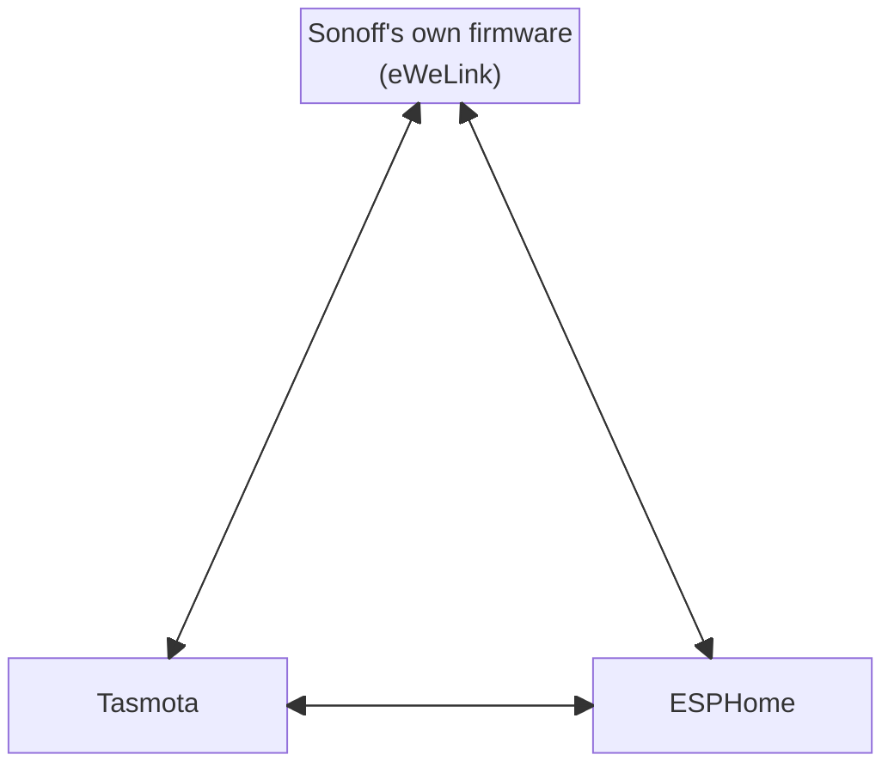

# Sonoff S60 → Tasmota or ESPHome, OTA
## Fully automated 'Over The Air' conversion


Turns a stock Sonoff S60 smart plug into one running **Tasmota** or
**ESPHome** using OTA method - no soldering, no taking the plug apart. Later
it moves the plug between the two, or back to Sonoff's own firmware, the same
way ([Changing firmware later](#changing-firmware-later)).

Until now, the established way to put Tasmota on an S60 was to open it and
flash it over USB-serial - hard work, because the case is plastic-welded shut.
The community threads for that method:

- UK version: [arendst/Tasmota#22554](https://github.com/arendst/Tasmota/discussions/22554)
- EU version: [arendst/Tasmota#21255](https://github.com/arendst/Tasmota/discussions/21255)

Conversion with this tool is fully automated end to end, with checks at every stage.  
It is resumable and can be restarted at any point.

Converted plugs end up byte-for-byte identical to a plug flashed over USB with
the official Tasmota release, the final automated checks verify this by reading their flash back at the end of the conversion.
ESPHome is checked the same way: every block of it is read back before the plug switches to it.

---

## Read this before you start

Please only do this with a plug you can afford to lose.

If the power is cut during memory write, the plug may not start again, and no amount of Wi-Fi cleverness
will bring it back - it would then need opening and a USB-serial adapter to recover.

**This is not official Sonoff software.** Converting the plug ends
any support or warranty you had, and the eWeLink app will no longer control it.

---

## What you need

| | |
|---|---|
| **The plug** | A Wi-Fi Sonoff S60 (ESP32-C3 inside): the UK **S60TPG** or the European **S60TPF**. Not the Zigbee S60 (S60ZB...), which has a different chip. |
| **An eWeLink account** | Free. A throwaway one is fine. The plug has to be added to it first. |
| **A computer** | Linux, macOS or Windows, with Wi-Fi. It needs Python 3.10 or newer, which the start script installs if need be. |
| **Administrator rights** | If the computer's firewall is on, the tool requests to add one temporary firewall rule (allowing the plug to communicate with the computer), and removes it when the run finishes - Adding this rule requires an admin/sudo elevation.  |

> The plug must be **allowed internet access** during the run: the conversion is sent to it
through eWeLink. If you normally keep it LAN-only, allow it for the run and block it again
afterwards - Tasmota needs no cloud.

### Wi-Fi

Your Wi-Fi must be **2.4 GHz** - the plug cannot use 5 GHz.

The plug keeps the Wi-Fi it was set up with in the eWeLink app, so set it up
there on the 2.4 GHz network it should stay on.  

[How your Wi-Fi details are handled](docs/technical-details.md#how-your-wi-fi-details-are-handled)

## What it has been run on

**Model**

- ✅ **S60TPG** - UK / Type G
- ✅ **S60TPF** - EU / Type E/F

**Stock firmware**

- ✅ 1.1.1
- ✅ 1.2.0

**Computer**

- ✅ Linux
- ✅ Windows
- ⬜ macOS (expected to work)

> ### MacOS
>
> If you are on Mac, please let us know how it went.
A report from a first run is what moves macOS
from "written for" to tested, so the next person can follow
knowing they have worked for someone already, and anything that
trips you up gets fixed for everyone after you.

## Doing it


**Linux / MacOS**  (Terminal)
```sh
git clone https://github.com/adamsthws/Sonoff-OTA.git
cd Sonoff-OTA
sh start.sh
```
**Windows** (Terminal)

```sh
git clone https://github.com/adamsthws/Sonoff-OTA.git
cd Sonoff-OTA
.\start.ps1
```
  -- or -- 
  [download as a zip](https://github.com/adamsthws/Sonoff-OTA/archive/refs/heads/main.zip), double-click `start.cmd`  

- Run the same command for every plug: it carries on an unfinished run, or
starts a new one. 

- First it looks for the plug. One still on Sonoff's firmware is offered
Tasmota or ESPHome ([Choosing ESPHome](#choosing-esphome)); one already on
Tasmota or ESPHome is offered the other two.

- Then you're walked through every step of the conversion.

- Finding the plug, backing up its Sonoff firmware,
installing Tasmota, rebuilding its memory and checking the result - happens automatically.

### If you have to stop

E.g. you close the window, lose your Wi-Fi, run out of time - it doesn't matter. Run the
same command again - `start.cmd` or `sh start.sh`.

It remembers which plug it was working on and what it had done. Where a step
was interrupted, it checks the plug to work out where to resume from.

## What you end up with

**Tasmota:** official Tasmota, laid out in memory exactly as if the plug had been flashed
over USB. That means normal Tasmota upgrades from then on.

**ESPHome:** ESPHome for the S60, on your Wi-Fi, ready for Home Assistant to find
([Choosing ESPHome](#choosing-esphome)).

The Tasmota [layout itself](docs/technical-details.md#the-finished-memory-layout) is
in the technical details.

You also keep a full backup of the plug's Sonoff firmware.

If you later change your Wi-Fi, the plug can be told the new one through its
own network: see [a converted plug that has lost your Wi-Fi](docs/troubleshooting.md#a-converted-plug-that-has-lost-your-wi-fi).

## Changing firmware later



Run the same command with a converted plug on your network: it finds the plug,
says what it runs, and offers the other two. Every way round is over the air,
with the same checks as the first conversion: every block written is read
back, and the plug only switches once it has all been checked.

- **Back to Sonoff's firmware** puts back the plug's own firmware and settings
  from the backup taken when it was first converted, so it is in the eWeLink app
  again as it was. It is only offered where that backup is on the computer
  doing it.
- **From ESPHome**, you are asked for your Wi-Fi password: ESPHome does not
  say what it is, and the firmware going on needs it written in.
- **The bootloader**, the small program that starts the plug's firmware, is
  replaced once, with ESPHome's, which starts all three and rolls back an
  update that fails to start. Writing it takes under a second; it and the
  memory map are the only moments a power cut would leave a plug that needs
  opening to repair.

## When something goes wrong

Start with **[docs/troubleshooting.md](docs/troubleshooting.md)** - it covers
the problems that actually came up while this was being built.

## How it works

The tool sends the plug the same kind of update command
Sonoff uses, but pointing at your computer, which hands it Tasmota.  

[What actually happens to your plug](docs/what-happens.md)

## Reporting how it went

Whether it worked first time or stopped partway, please
report back on how it went here:  
- **[Test reports](https://github.com/adamsthws/Sonoff-OTA/discussions/1)**

> A clean conversion, a run that stopped partway, or only the read-only checks - all of it is useful. 

> Reading the thread is the quickest way to see what has
worked for others.


## Choosing ESPHome

Pick **ESPHome** when the tool asks, and the plug ends up running
[ESPHome](https://esphome.io) instead of Tasmota - on your Wi-Fi, with nothing
to build or install on your computer: the tool installs a ready-made ESPHome
for the S60 ([`ESPHome/sonoff_s60.yaml`](ESPHome/sonoff_s60.yaml)) and writes your Wi-Fi
into it, in memory only.

- **The plug:** relay and button, the status LED, the power meter (voltage,
  current, power, daily, monthly, yearly and total energy), overload
  protection and a countdown timer. After a power cut the relay comes back as
  it was.
- **Its web page** is at the link the tool gives at the end, and works without
  the internet. Like Tasmota, it has no password to start with.
- **Home Assistant** finds it by itself. Adopting it in Home Assistant's ESPHome
  builder takes its config from this repository, so you can change it and
  add passwords and an API key there.
- **Updates** are ESPHome's own, from Home Assistant or ESPHome's tools.
- **Its memory** stays laid out as Sonoff made it: ESPHome goes into the half
  Sonoff's firmware updates used, which is enough for it. Sonoff's bootloader
  is replaced by ESPHome's own, so an update that fails to start is rolled
  back to the one before by itself. Writing it takes under a second, and is
  the one moment of the run when a power cut would leave a plug that needs
  opening to repair.

The ESPHome option was contributed by [p1otr](https://github.com/p1otr).

## More detail

- **[docs/technical-details.md](docs/technical-details.md)** - the firmware
  bundle, secrets handling, memory layout, notes for devs.
- **[docs/what-happens.md](docs/what-happens.md)** - how it works and what
  happens to the plug, step by step.
- **[docs/troubleshooting.md](docs/troubleshooting.md)** - problems met so far
  and their fixes.
- **[docs/emulator.md](docs/emulator.md)** - the whole conversion run against
  an emulated s60 plug.
- **[docs/unattended.md](docs/unattended.md)** - running a conversion with
  nobody at the keyboard - for testing.
- **[docs/upstream-contributions.md](docs/upstream-contributions.md)** - bugs
  found and fixed while building this project.
- **[archive/docs/reference/](archive/docs/reference/)** - the original
  research, the manual procedure and how the firmware format was decoded.
- **[docs/legal.md](docs/legal.md)** - how the project keeps backing up
  Sonoff's firmware lawful, and what it asks of you.

## Thanks

This is a fork of [HG0161/SonoffS60OTA](https://github.com/HG0161/SonoffS60OTA),
which did the groundwork of working out the OTA route.

A big thank you to [HG0161](https://github.com/HG0161) and the original
[SonoffS60OTA](https://github.com/HG0161/SonoffS60OTA) repository for working out the update mechanism, decoding the firmware format
and proving the OTA route on real plugs. This repository carries that work on.

Thanks to [p1otr](https://github.com/p1otr) for the ESPHome option and its
S60 config.

Thanks too to everyone in the Tasmota threads for the
[UK](https://github.com/arendst/Tasmota/discussions/22554) and
[EU](https://github.com/arendst/Tasmota/discussions/21255) S60, whose
open-the-case method came first.

Worked out with the Tasmota community's discussion of this device, and built on
Tasmota itself. Tasmota is GPL-3.0-only; so is this.

See [`LICENSE`](LICENSE) and [`THIRD_PARTY_NOTICES.md`](THIRD_PARTY_NOTICES.md).
