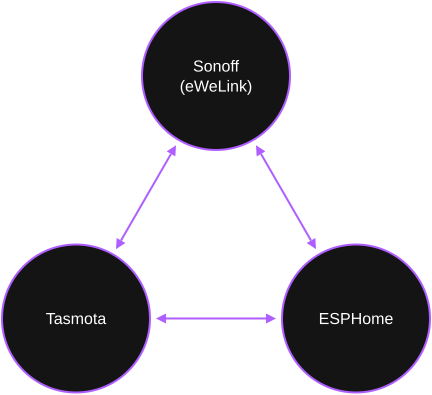

# Firmware Liberator
**Sonoff eWeLink → Tasmota, OpenBeken, ESPHome**
> **Your Firmware Flasher Tool**  
(Fully OTA - 'Over The Air' - I.e Flash over Wi-Fi)

<br>

[](#what-it-supports)

[](docs/updating-firmware.md) [](docs/updating-firmware.md) [](docs/updating-firmware.md)

[](https://github.com/adamsthws/firmware-liberator/releases/latest) [](https://github.com/adamsthws/firmware-liberator/actions/workflows/emulator-check.yml) [](LICENSE)

[%20total&replace=%241&label=Discussions&color=blue)](https://github.com/adamsthws/firmware-liberator/discussions) [%20open&replace=%241&label=Issues&color=blue)](https://github.com/adamsthws/firmware-liberator/issues) [%20open&replace=%241&label=Pull%20Requests&color=blue)](https://github.com/adamsthws/firmware-liberator/pulls) [](https://github.com/adamsthws/firmware-liberator/releases)

<br>

## Keep this tool alive and growing  
Your donation goes toward expansion, supporting many more devices - Thankyou!  


[](https://github.com/sponsors/adamsthws) [](https://ko-fi.com/adamsthws) [](https://www.paypal.me/adamsthws)  

> Bonus: Sponsor through GitHub and you earn the coveted Sponsor achievement on your profile: 

<br>

### Liberation From The Cloud

Your device answers to you alone, on your own network.
> Removes dependence on external cloud servers. After flashing you'll no longer require a cloud account or third party app, and even after a cloud service is switched off your device keeps working and remains fully under your control.

<br>

### Any Direction

And every route between them.
> Stock Sonoff to Tasmota, OpenBeken or ESPHome, either to the other, and back to Sonoff's own firmware if you change your mind.

<br>




<br>

### Fully automated 'Over The Air' firmware conversion

Turn your stock Sonoff S60 smart plug into one running **Tasmota** or **ESPHome** using OTA method - no soldering, no taking the plug apart. Move the plug between the two, or back to Sonoff's own firmware. The S61S, with **OpenBeken** too, is coming soon.

> Conversion with this tool is fully automated end to end, with checks at every stage. It is resumable and can be restarted at any point.

<br>

### No More Soldering

Until now, the established way to put Tasmota on an S60 was to open it, perform some soldering and
flash it over USB-serial - hard work, because the case is plastic-welded shut.

> The community threads for the soldering method:
>
> - UK version: [arendst/Tasmota#22554](https://github.com/arendst/Tasmota/discussions/22554)
> - EU version: [arendst/Tasmota#21255](https://github.com/arendst/Tasmota/discussions/21255)

<br>

### Indistinguishable

Converted plugs end up identical to a plug flashed over USB
> The final automated checks verify this by reading their flash back at the end of the conversion. Every block of it is read back before the plug switches to it.

<br>

## What you need

**The plug** 
> A Wi-Fi Sonoff S60, e.g:  
UK: **S60TPG** | European: **S60TPF**  
(Not the Zigbee S60)  
The S61S (iPlug Gen2, model **S61STPF**) is being worked on: see [devices/sonoff-s61/](devices/sonoff-s61/).

**An eWeLink account**
> Free. A throwaway one is fine. The plug has to be added to it first.

**A computer**
> Linux, macOS or Windows, with Wi-Fi.

**Administrator rights**
> The tool needs them to add one temporary firewall rule (allowing the plug to communicate with your computer, removed when the tool finishes).

<br>

## What it supports
> Support for more devices coming soon.

**Model**

- ✅ **Sonoff S60TPG** - UK / Type G
- ✅ **Sonoff S60TPF** - EU / Type E/F

**Stock firmware**

- ✅ 1.1.1
- ✅ 1.2.0

**Computer**

- ✅ Linux
- ✅ Windows
- ✅ macOS

<br>

## Let's go

Simply paste this one line into your terminal...

>You're walked through every step of the conversion. The line downloads the latest release into your home folder and starts it.

**Windows**
```
powershell -c "irm https://github.com/adamsthws/firmware-liberator/releases/latest/download/liberate.ps1 | iex"
```

**macOS**
```sh
sh -c "$(curl -fsSL https://github.com/adamsthws/firmware-liberator/releases/latest/download/liberate.sh)"
```
**Linux**
```sh
sh -c "$(wget -qO- https://github.com/adamsthws/firmware-liberator/releases/latest/download/liberate.sh)"
```
> If that says `wget: not found`, use the macOS line instead.

<details>
<summary>Or with git, or a zip</summary>

```sh
git clone https://github.com/adamsthws/firmware-liberator.git
cd firmware-liberator
sh start.sh       # Linux / macOS
.\start.cmd       # Windows
```
-- or -- [download as a zip](https://github.com/adamsthws/firmware-liberator/archive/refs/heads/main.zip), and double-click `start.cmd`
</details>

<br>

## What you'll see

**Tasmota:**



**ESPHome:**



<br>

## If you have to stop

E.g. you close the window, lose your Wi-Fi, run out of time - it doesn't matter. Run the
same command again - the one line above, or `start.cmd` / `sh start.sh` in the folder.

> It remembers which plug it was working on and what it had done. Where a step
was interrupted, it checks the plug to work out where to resume from.

<br>

## What you end up with

**Tasmota:** Official Tasmota

**ESPHome:** Official ESPHome

**Sonoff:** A full backup of the plug's Sonoff firmware to restore later.

> Afterward, you update Tasmota and ESPHome as normal. Or run the tool again to update your plug's Tasmota, or this project's ESPHome, to the release the tool installs, keeping its settings.

<br>

## If something goes wrong

Start with **[docs/troubleshooting.md](docs/troubleshooting.md)** - it covers
the problems that actually came up while the tool was being built.

<br>

## Reporting how it went

Whether it worked first time or stopped partway, please
report back on how it went here:  
- **[Conversions In The Wild (Conversion Reports)](https://github.com/adamsthws/firmware-liberator/discussions/1)**

> A clean conversion, a run that stopped partway, or only the read-only checks - all of it is useful. 

> Reading the thread is the quickest way to see how it went for others.

<br>

## More detail

- **[docs/technical-details.md](docs/technical-details.md)** - the firmware
  bundle, secrets handling, memory layout, notes for devs.
- **[docs/what-happens.md](docs/what-happens.md)** - how it works and what
  happens to the plug, step by step.
- **[docs/troubleshooting.md](docs/troubleshooting.md)** - problems met so far
  and their fixes.
- **[docs/emulator.md](docs/emulator.md)** - the whole conversion run against
  an emulated s60 plug.
- **[docs/unattended.md](docs/unattended.md)** - running a conversion with
  nobody at the keyboard - for testing.
- **[docs/testing.md](docs/testing.md)** - how the tool is tested: unit tests,
  the emulator, every fault in the way of every step, and real plugs.
- **[docs/updating-firmware.md](docs/updating-firmware.md)** - how the
  Tasmota and ESPHome the tool installs are updated to each new release.
- **[docs/private-backup.md](docs/private-backup.md)** - for the maintainer:
  how their own Sonoff backup is kept sealed and private, off their computer.
- **[docs/device-names.md](docs/device-names.md)** - the name the plug goes by
  at each stage, where each is set, and how to change them.
- **[docs/upstream-contributions.md](docs/upstream-contributions.md)** - bugs
  found and fixed while building this project.
- **[archive/docs/reference/](archive/docs/reference/README.md)** - the original
  research, the manual procedure and how the firmware format was decoded.
- **[docs/legal.md](docs/legal.md)** - how the project keeps backing up
  Sonoff's firmware lawful, and what it asks of you.

<br>

## Roadmap

This project has big ambitions. The difficult groundwork has been laid down
to support devices built on both **Espressif** and **Beken** chips.

> Next is expanding the list of supported devices - more Espressif-based
> and more Beken-based ones alike.

Also being considered: support for **Supla** firmware, **Zamel** modules and
**Tuya** devices.

<br>

## Thanks

Thanks too to everyone in the Tasmota threads for the
[UK](https://github.com/arendst/Tasmota/discussions/22554) and
[EU](https://github.com/arendst/Tasmota/discussions/21255) S60, whose
open-the-case method came first.

A big thank you to [HG0161](https://github.com/HG0161) and the
[SonoffS60OTA](https://github.com/HG0161/SonoffS60OTA) repository for working out the update mechanism, decoding the firmware format and proving the OTA update route. (Worked out with the Tasmota community's discussion of this device).

Thanks to [lcgamboa](https://github.com/lcgamboa) for the
[QEMU fork](https://github.com/lcgamboa/qemu) that emulates the ESP32, and to [openshwprojects](https://github.com/openshwprojects) for the
[Beken emulator](https://github.com/openshwprojects/BekenEmulator). Every conversion is tested against them before it reaches a real plug.

Thanks to [p1otr](https://github.com/p1otr) for the ESPHome option and its
S60 config.

See [`LICENSE`](LICENSE) and [`NOTICES.md`](NOTICES.md).

<br>

## To Sonoff and eWeLink

Thankyou for making such excellent devices. Please keep this update method open. Letting owners run their own firmware is a win for you as well as
for them.

**It sells plugs.**
> Tasmota began life as *Sonoff-Tasmota*: a great many people first bought
> Sonoff because they could reflash it, and the home-automation community
> still recommends the brand for that reason. Every plug this tool supports
> is one more reason to choose Sonoff over a sealed alternative - and the
> sale is yours either way.

**It costs you less.**
> A converted plug never calls your servers again. You keep the sale and drop
> the years of cloud traffic, accounts and app support that would have come
> with it. Sell more, support less.

**The owners support themselves.**
> Someone who installs their own firmware takes on its upkeep. Tasmota,
> ESPHome and OpenBeken are maintained by their own communities, at no cost
> to you.

**Nothing is lost.**
> The tool needs the owner's own plug, added to their own eWeLink account.
> It touches no one else's device, and it keeps the plug's Sonoff firmware so
> it can be put back at any time.

**It earns goodwill.**
> Your own DIY mode once let owners flash their own firmware over Wi-Fi: you
> have seen the value in this before. A device that outlives
> its app, or its cloud service, stays out of a landfill and keeps its
> owner's trust in the brand that made it.

<br>