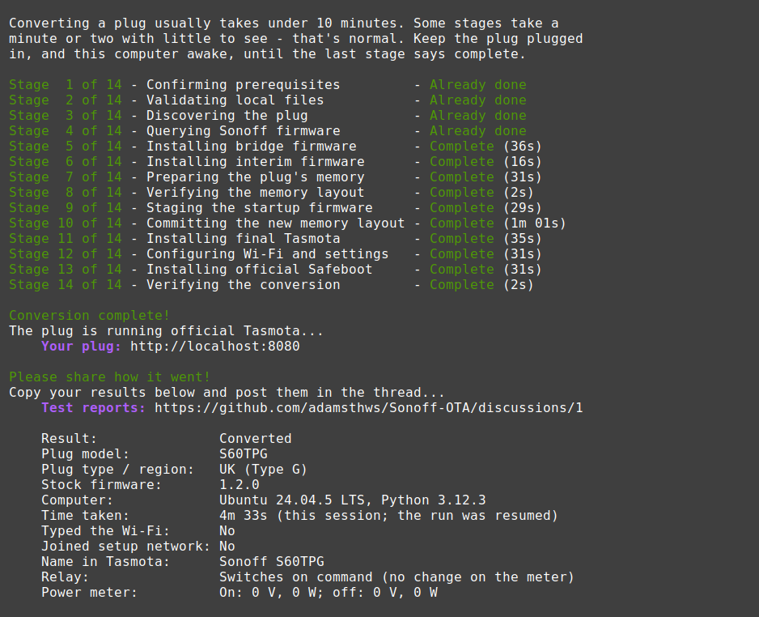

# Sonoff S60 → Tasmota, OTA
## Fully automated 'Over The Air' conversion



Turns a stock Sonoff S60 smart plug into one running **Tasmota** using
OTA method - no soldering, no taking the plug apart.

Until now, the established way to put Tasmota on an S60 was to open it and
flash it over USB-serial - hard work, because the case is plastic-welded shut.
The community threads for that method:

- UK version: [arendst/Tasmota#22554](https://github.com/arendst/Tasmota/discussions/22554)
- EU version: [arendst/Tasmota#21255](https://github.com/arendst/Tasmota/discussions/21255)

It is fully automated end to end: one script, with checks at every stage. It
is resumable and can be restarted at any point.

Converted plugs end up byte-for-byte identical to a plug flashed over USB with
the official Tasmota release, the final automated checks verify this by reading their flash back at the end of the cenversion.

```sh
git clone https://github.com/adamsthws/Sonoff-OTA.git
cd Sonoff-OTA
sh start.sh          # macOS and Linux; on Windows, double-click start.cmd
```

No extra packages, just Python 3.10+ - which the start script installs for you
on Windows or a Mac if you have none. See [Doing it](#doing-it).

---

## Read this before you start

**This is a mains-voltage device and one step cannot be undone.**

If the power is cut during brief memory write, the plug will not start again, and no amount of Wi-Fi cleverness
will bring it back - it would need opening and a USB-serial adapter to recover. Plug it into a socket nobody is
going to switch off until the run finishes.

Please only do this with a plug you can afford to lose.

**This is not official Sonoff software.** Converting the plug ends
any support or warranty you had, and the eWeLink app will no longer control it.

---

## What you need

| | |
|---|---|
| **The plug** | A Wi-Fi Sonoff S60 (ESP32-C3 inside): the UK **S60TPG** or the European **S60TPF**. Not the Zigbee S60 (S60ZB...), which has a different chip. |
| **An eWeLink account** | Free. A throwaway one is fine. The plug has to be added to it first. |
| **A computer** | Linux, macOS or Windows, with Wi-Fi. It needs Python 3.10 or newer, which the start script installs if need be. |
| **Administrator rights** | If the computer's firewall is on, the tool requests to add one temporary firewall rule (allowing the plug to communicate with the computer), and removes it when the run finishes - Adding this rule requires an admin/sudo elevation.  |

Your Wi-Fi must be **2.4 GHz** - the plug cannot use 5 GHz.

The plug must be **allowed internet access** during the run: the conversion is sent to it
through eWeLink. If you normally keep it LAN-only, allow it for the run and block it again
afterwards - Tasmota needs no cloud.

## What it has been run on

**Model**

- ✅ **S60TPG** - UK / Type G
- ✅ **S60TPF** - EU / Type E/F

**Stock firmware**

- ✅ 1.1.1
- ✅ 1.2.0

**Computer**

- ✅ Linux - (fully tested end to end)
- ✅ Windows - (fully tested end to end)
- ⬜ macOS - (one tester reported issues - more testing required)

### Windows and macOS

Every conversion so far was run from Linux. The tool is written for Windows
and macOS too - finding the plug and managing the temporary firewall rule,
each have their own code for those systems - but none of it has been through a
real conversion yet. If you are on Windows or a Mac, please give it a go and
let us know how it went. A report from a first run is what moves Windows or
macOS from "written for" to tested, so the next person can follow the
instructions knowing they have worked for someone already, and anything that
trips you up gets fixed for everyone after you.

### Wi-Fi

The plug keeps the Wi-Fi it was set up with in the eWeLink app, so set it up
there on the 2.4 GHz network it should stay on.

Your Wi-Fi password is never written to your computer's disk.
[How your Wi-Fi details are handled](docs/technical-details.md#how-your-wi-fi-details-are-handled)
has the detail.

## Doing it

Get the code - with git, or
[as a zip](https://github.com/adamsthws/Sonoff-OTA/archive/refs/heads/main.zip)
to unpack:

```sh
git clone https://github.com/adamsthws/Sonoff-OTA.git
cd Sonoff-OTA
```

Then start it:

| On | Do this |
|---|---|
| **Windows** | Double-click `start.cmd` - or, in PowerShell, `.\start.ps1` |
| **macOS** | In Terminal, in the folder: `sh start.sh` |
| **Linux** | In a terminal, in the folder: `sh start.sh` |

The tool leaves your computer as it found it:

- **Windows and Linux:** it uses a pinned, portable Python - the same one for
  everyone - unpacked into a `.python` folder in this one. Nothing is
  installed, and deleting the folder removes it. (Windows: python.org's own,
  about 11 MB. Linux: the standalone builds uv uses, about 30 MB.)
- **macOS:** macOS is wary of unsigned programs, and python.org's signed
  Python has to be installed. So the script uses a Python 3.10 or newer you
  already have - and only if there is none does it offer to install.
  (macOS asks for your permission and password beforehand).

Run the same command for every plug: it carries on an unfinished run, or
starts a new one. The screen shows one line per stage as it goes and it walks you through the conversion. Everything else goes to a log, `captures/<run>/run.log`, and `--verbose` shows it all live.

Everything else - finding the plug, installing Tasmota, rebuilding its memory
and checking the result - happens by itself.
[What actually happens to your plug](docs/what-happens.md#the-run-step-by-step)
goes through it stage by stage.

## How it works

Signed in as you, the tool sends the plug the same kind of update command
Sonoff uses, but pointing at your computer, which hands it Tasmota.
[What actually happens to your plug](docs/what-happens.md) explains it in
plain English, including why one step is risky.

### If you have to stop

Close the window, lose your Wi-Fi, run out of time - it doesn't matter. Run the
same command again - `start.cmd` or `sh start.sh`.

It remembers which plug it was working on and what it had done. Where a step
was interrupted, it checks the plug to work out whether that step finished,
and only asks you if the plug cannot show it.

The temporary firewall rule is removed whenever the tool exits, however the
run ended; a resumed run adds it again. To give up on a plug part-way, and
remove anything a run that was killed outright left behind:

```sh
sh start.sh cleanup      # on Windows: .\start.ps1 cleanup
```

## What you end up with

Official Tasmota, laid out in memory exactly as if the plug had been flashed
over USB. That means normal Tasmota upgrades from then on, more room for
firmware than the Sonoff layout allowed, and a filesystem the plug never had.
The [layout itself](docs/technical-details.md#the-finished-memory-layout) is
in the technical details.

After it finishes, check the physical side yourself: the relay clicks, the
button toggles it, the LED follows, and with a load plugged in the voltage,
current and power readings look sensible.

## When something goes wrong

Start with **[docs/troubleshooting.md](docs/troubleshooting.md)** - it covers
the problems that actually came up while this was being built, including what
each one looked like on screen.

The most common causes are a firewall on your computer blocking the plug, and
the computer's address changing partway through.

### Reporting how it went

Whether it worked first time or stopped partway, please
report back on how it went - including any prompts from
the system along the way, such as the Windows permission dialog, Windows
Security asking about Python, or the macOS firewall, and what you chose.

Every report goes in one place: the pinned
[Test reports](https://github.com/adamsthws/Sonoff-OTA/discussions/1) thread in the
repository's Discussions. The tool also offers the link, with this run's
details ready to paste, when a conversion finishes.
A clean conversion, a run that stopped partway, or only the read-only checks -
all of it is useful. Reading the thread is the quickest way to see what has
worked for others, and each report is how a model, firmware version or
computer gets ticked off in [What it has been run on](#what-it-has-been-run-on).

Please include:

- **the plug:** the model printed on it (S60TPG, S60TPF, ...), its plug type
  or region, and the stock firmware version the eWeLink app showed before
  converting;
- **the computer:** Windows, macOS or Linux and its version, and
  `python --version`;
- **the run:** how far it got and roughly how long it took, and whether it
  asked you to type the Wi-Fi or join the plug's setup network;
- **the result:** the name Tasmota's page shows, and whether the relay,
  button, LED and power readings behave;
- **if it stopped:** the on-screen messages around where it stopped.

The thread is for reports, not for asking for help. If you are stuck, start a
[discussion](https://github.com/adamsthws/Sonoff-OTA/discussions)
of your own, or open an [issue](https://github.com/adamsthws/Sonoff-OTA/issues)
if something clearly needs fixing in the code - and link it from your report
so the thread stays complete.

The run's log, `captures/<run>/run.log`, has the full detail if you are asked
for it. It is safe to share: your eWeLink email, Wi-Fi name and password, the
plug's device id, name and hardware address, public IP addresses and your
home folder are written as `<email>`, `<wifi-name>` and so on. Addresses on
your home network stay, as they are needed to follow the run.

### Going on to ESPHome

Once the plug is running Tasmota, it is an ordinary Tasmota device, so if
you would rather run **ESPHome** you can follow ESPHome's own standard
route from there:
[Migrating from Tasmota](https://esphome.io/guides/migrate_sonoff_tasmota/).
It is also done over the air, through Tasmota's Firmware Upgrade page.

## Safety, and why you can believe the checks

- **Nothing is trusted, everything is checked.** Every firmware file is
  checked against a known fingerprint before use, and the finished plug is
  read back and compared against the official release.
- **The risky steps need you to say yes.** The conversion only starts after
  you type PROCEED - not a y/n - below a warning that spells out the risk.
- **The plug checks too.** Every stage that writes refuses to run unless the
  plug is in exactly the state it expects, and says so rather than guessing.
- **Nothing private is published.** Each run keeps its records in `captures/`,
  which git ignores.

## More detail

- **[docs/technical-details.md](docs/technical-details.md)** - the firmware
  bundle, how secrets are handled, the finished memory layout, and notes for
  developers.
- **[docs/what-happens.md](docs/what-happens.md)** - how it works and what
  happens to the plug, step by step.
- **[docs/troubleshooting.md](docs/troubleshooting.md)** - problems met so far
  and their fixes.
- **[docs/unattended.md](docs/unattended.md)** - running a conversion with
  nobody at the keyboard, for testing, and keeping the screen it drew.
- **[archive/docs/reference/](archive/docs/reference/)** - the original
  research, the manual procedure and how the firmware format was decoded.

## Thanks

This is a fork of [HG0161/SonoffS60OTA](https://github.com/HG0161/SonoffS60OTA),
which did the groundwork of working out the OTA route.

A big thank you to [HG0161](https://github.com/HG0161) and the original
[SonoffS60OTA](https://github.com/HG0161/SonoffS60OTA) repository, which did
the groundwork: working out the update mechanism, decoding the firmware format
and proving the OTA route on real plugs. This repository carries that work on.

Thanks too to everyone in the Tasmota threads for the
[UK](https://github.com/arendst/Tasmota/discussions/22554) and
[EU](https://github.com/arendst/Tasmota/discussions/21255) S60, whose
open-the-case method came first.

Worked out with the Tasmota community's discussion of this device, and built on
Tasmota itself. Tasmota is GPL-3.0-only; so is this.

See [`LICENSE`](LICENSE) and [`THIRD_PARTY_NOTICES.md`](THIRD_PARTY_NOTICES.md).
