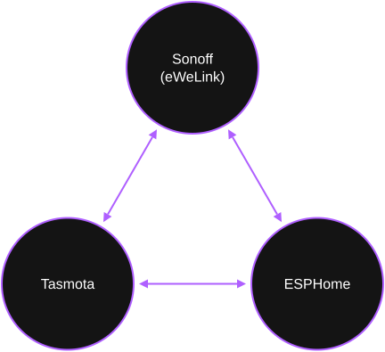

# Sonoff S60 → Tasmota or ESPHome, OTA
***Flash it, don't smash it.***

[](docs/updating-firmware.md) [](docs/updating-firmware.md)

[](https://github.com/adamsthws/Sonoff-OTA/releases/latest) [](https://github.com/adamsthws/Sonoff-OTA/releases) [](https://github.com/adamsthws/Sonoff-OTA/actions/workflows/emulator-check.yml) [](https://github.com/adamsthws/Sonoff-OTA/actions/workflows/lint.yml) [](LICENSE) [](#what-it-has-been-run-on) [](https://github.com/adamsthws/Sonoff-OTA/discussions) [](https://ko-fi.com/adamsthws)

<br>
<br>



<br>
<br>

## Fully automated 'Over The Air' firmware conversion

Turn your stock Sonoff S60 smart plug into one running **Tasmota** or
**ESPHome** using OTA method - no soldering, no taking the plug apart. Move the plug between the two, or back to Sonoff's own firmware.

> Conversion with this tool is fully automated end to end, with checks at every stage. It is resumable and can be restarted at any point.

<br>

### No More Soldering

Until now, the established way to put Tasmota on an S60 was to open it, perform some soldering and
flash it over USB-serial - hard work, because the case is plastic-welded shut.

> The community threads for the soldering method:
>
> - UK version: [arendst/Tasmota#22554](https://github.com/arendst/Tasmota/discussions/22554)
> - EU version: [arendst/Tasmota#21255](https://github.com/arendst/Tasmota/discussions/21255)

<br>

### Indistinguishable

Converted plugs end up byte-for-byte identical to a plug flashed over USB
> The final automated checks verify this by reading their flash back at the end of the conversion. Every block of it is read back before the plug switches to it.

<br>

## What you need

**The plug** 
> A Wi-Fi Sonoff S60, e.g:  
UK: **S60TPG** | European: **S60TPF**  
(Not the Zigbee S60)

**An eWeLink account**
> Free. A throwaway one is fine. The plug has to be added to it first.

**A computer**
> Linux, macOS or Windows, with Wi-Fi.

**Administrator rights**
> Required to auto-add one temporary firewall rule (allowing the plug to communicate with the computer, removed when the run finishes).

<br>

## What it has been run on

**Model**

- ✅ **S60TPG** - UK / Type G
- ✅ **S60TPF** - EU / Type E/F

**Stock firmware**

- ✅ 1.1.1
- ✅ 1.2.0

**Computer**

- ✅ Linux
- ✅ Windows
- ✅ macOS

<br>

## Let's go

> You're walked through every step of the conversion.

**Linux / MacOS**  (Terminal)
```sh
git clone https://github.com/adamsthws/Sonoff-OTA.git
cd Sonoff-OTA
sh start.sh
```
**Windows** (Terminal)

```sh
git clone https://github.com/adamsthws/Sonoff-OTA.git
cd Sonoff-OTA
.\start.ps1
```
  -- or -- 
  [download as a zip](https://github.com/adamsthws/Sonoff-OTA/archive/refs/heads/main.zip), double-click `start.cmd`  

<br>

## What you'll see



<br>

## If you have to stop

E.g. you close the window, lose your Wi-Fi, run out of time - it doesn't matter. Run the
same command again - `start.cmd` or `sh start.sh`.

> It remembers which plug it was working on and what it had done. Where a step
was interrupted, it checks the plug to work out where to resume from.

<br>

## What you end up with

**Tasmota:** Official Tasmota

**ESPHome:** Official ESPHome, ready for Home Assistant to find.

**Sonoff:** A full backup of the plug's Sonoff firmware to restore later.

> The firmware is laid out in memory exactly as if the plug had been flashed
over USB. That means normal upgrades from then on.

<br>

## If something goes wrong

Start with **[docs/troubleshooting.md](docs/troubleshooting.md)** - it covers
the problems that actually came up while this was being built.

<br>

## Reporting how it went

Whether it worked first time or stopped partway, please
report back on how it went here:  
- **[Conversions In The Wild (Conversion Reports)](https://github.com/adamsthws/Sonoff-OTA/discussions/1)**

> A clean conversion, a run that stopped partway, or only the read-only checks - all of it is useful. 

> Reading the thread is the quickest way to see how it went for others.

A security problem is reported privately instead: see [SECURITY.md](SECURITY.md).

<br>

## More detail

- **[docs/technical-details.md](docs/technical-details.md)** - the firmware
  bundle, secrets handling, memory layout, notes for devs.
- **[docs/what-happens.md](docs/what-happens.md)** - how it works and what
  happens to the plug, step by step.
- **[docs/troubleshooting.md](docs/troubleshooting.md)** - problems met so far
  and their fixes.
- **[docs/emulator.md](docs/emulator.md)** - the whole conversion run against
  an emulated s60 plug.
- **[docs/unattended.md](docs/unattended.md)** - running a conversion with
  nobody at the keyboard - for testing.
- **[docs/testing.md](docs/testing.md)** - how the tool is tested: unit tests,
  the emulator, every fault in the way of every step, and real plugs.
- **[docs/updating-firmware.md](docs/updating-firmware.md)** - how the
  Tasmota and ESPHome the tool installs are moved to each new release.
- **[docs/private-backup.md](docs/private-backup.md)** - for the maintainer:
  how their own Sonoff backup is kept sealed and private, off their computer.
- **[docs/device-names.md](docs/device-names.md)** - the name the plug goes by
  at each stage, where each is set, and how to change them.
- **[docs/upstream-contributions.md](docs/upstream-contributions.md)** - bugs
  found and fixed while building this project.
- **[archive/docs/reference/](archive/docs/reference/)** - the original
  research, the manual procedure and how the firmware format was decoded.
- **[docs/legal.md](docs/legal.md)** - how the project keeps backing up
  Sonoff's firmware lawful, and what it asks of you.

<br>

## Thanks

This is a fork of [HG0161/SonoffS60OTA](https://github.com/HG0161/SonoffS60OTA),
which did the groundwork of working out the OTA route.

A big thank you to [HG0161](https://github.com/HG0161) and the original
[SonoffS60OTA](https://github.com/HG0161/SonoffS60OTA) repository for working out the update mechanism, decoding the firmware format
and proving the OTA route on real plugs. This repository carries that work on.

Thanks to [p1otr](https://github.com/p1otr) for the ESPHome option and its
S60 config.

Thanks too to everyone in the Tasmota threads for the
[UK](https://github.com/arendst/Tasmota/discussions/22554) and
[EU](https://github.com/arendst/Tasmota/discussions/21255) S60, whose
open-the-case method came first.

Worked out with the Tasmota community's discussion of this device.

See [`LICENSE`](LICENSE) and [`THIRD_PARTY_NOTICES.md`](THIRD_PARTY_NOTICES.md).
